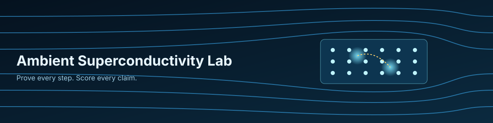
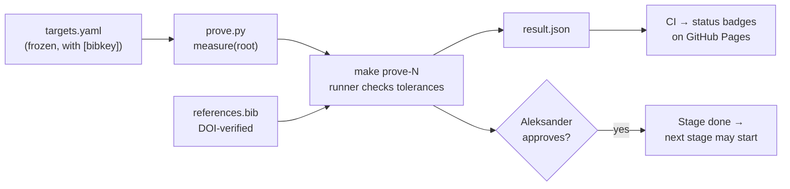

<p align="center">
  
</p>

<p align="center">
  <a href="https://github.com/Normansrule/ambient-superconductivity-lab/actions/workflows/ci.yml"></a>
  <a href="https://github.com/Normansrule/ambient-superconductivity-lab/actions/workflows/pages.yml"></a>
  <a href="LICENSE"></a>
  <a href="LICENSE-docs"></a>
</p>

**A staged, provable, open platform toward the search for ambient-pressure, room-temperature superconductors — and a trustworthy tool for evaluating the claims made along the way.**

Every stage ends in an automated proof (`make prove-N`) that anyone can rerun. Predictions are preregistered with a git tag and a Zenodo Digital Object Identifier (DOI) before they are tested, so a future confirmation or refutation is itself provable.

🌐 **Site:** <https://normansrule.github.io/ambient-superconductivity-lab/>

## Status

The table is generated from [`proofs/registry.yaml`](proofs/registry.yaml) by `make readme`; each badge is published by continuous integration (CI) after `make prove-all`.

<!-- STATUS:START -->
| Stage | Goal | Time | Cost | State | Proof (live from CI) |
|---|---|---|---|---|---|
| S0 | [Foundation](proofs/stage0/PROOF.md) | 1 week | $0 | done (proved and approved) |  |
| S1 | [Theory engine](ROADMAP.md#stages) | 3 weeks | $0 | planned |  |
| S2 | [Curated data and landscape](ROADMAP.md#stages) | 2–3 weeks | $0 | planned |  |
| S3 | [Machine learning screening baseline](ROADMAP.md#stages) | 3–4 weeks | $0 | planned |  |
| S4 | [Claim checklist (flagship)](ROADMAP.md#stages) | 3 weeks | $0 | planned |  |
| S5 | [Tabletop measurement](ROADMAP.md#stages) | 4–6 weeks | TODO: verify cap | planned |  |
| S6 | [First-principles check (optional)](ROADMAP.md#stages) | 4–6 weeks | compute only | planned |  |
| S7 | [Preregistered predictions preprint](ROADMAP.md#stages) | 4 weeks | $0 | planned |  |
| S8 | [Collaboration proposal](ROADMAP.md#stages) | ongoing | $0 | planned |  |
<!-- STATUS:END -->

## How this lab uses words

| Word | Meaning here |
|---|---|
| **superconductor** | Zero resistance *and* bulk diamagnetism, independently replicated, with a citation |
| **claimed** | Someone asserted superconductivity; the record is not settled or has been refuted |
| **predicted** | A model in this repository says it might be; nobody has measured it |
| **screened** | A candidate passed a filter (for example, thermodynamic stability); says nothing about Tc |

A candidate in this repository is **never** called a superconductor.

## How a stage is proved



Each stage folder [`proofs/stageN/`](proofs/) holds `targets.yaml`, `prove.py`, and a human-readable `PROOF.md`. Targets for physical quantities must cite a reference in [`docs/references.bib`](docs/references.bib), and every DOI there is checked against the registry by `make verify-refs`.

## Quick start

On Ubuntu (including WSL2) with Miniforge:

```bash
git clone git@github.com:Normansrule/ambient-superconductivity-lab.git
cd ambient-superconductivity-lab
make env                 # creates the conda environment `asl`
conda activate asl
python -m pytest         # unit tests
make prove-0             # verifies every DOI online, then runs the Stage 0 proof
make site-dev            # the 3D site at http://localhost:5173
```

`make help` lists every target. To re-prove Stage 0 from the committed verification cache without network access, run `ASL_OFFLINE=1 make prove-0`.

## Repository map

```text
docs/          theory/, landscape/, screening/, measurement/, claims/, experiments/,
               papers/, session_logs/, references.bib (+ references.verified.json)
src/asl/       theory/, data/, screening/, claims/, measurement/, proofs/, refs/
proofs/        registry.yaml and one folder per stage
data/          datasets, each with a provenance card (see PROVENANCE_TEMPLATE.md)
site/          Vite + React + TypeScript + react-three-fiber site with Playwright tests
animations/    Manim scenes (rendered in CI at low quality)
notebooks/     exploratory notebooks (never the source of a proof)
tests/         unit tests (`python -m pytest`)
```

## Roadmap

Stages S0–S8 run from the foundation through a theory engine, a curated dataset, a machine learning (ML) screening baseline, the flagship claim checklist, a tabletop yttrium barium copper oxide (YBCO) measurement, an optional first-principles check, a preregistered preprint, and a collaboration proposal. See [`ROADMAP.md`](ROADMAP.md).

## Contributing and citing

Read [`CONTRIBUTING.md`](CONTRIBUTING.md) first; its six rules are what make the results trustworthy. To cite the project, use [`CITATION.cff`](CITATION.cff) (GitHub's "Cite this repository" button reads it).

## License

Code is released under the [MIT License](LICENSE). Documentation, written proofs, and rendered media are released under [CC BY 4.0](LICENSE-docs).
